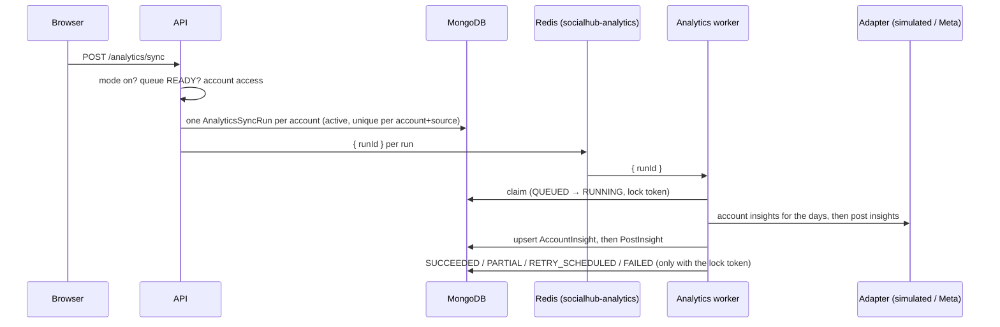

# Analytics & Publishing Intelligence

How SocialHub reports on publishing and on Facebook and Instagram performance, the API the
Analytics screen (`/w/:slug/analytics`) uses, and what is still needed before Meta insights
can be read for real. Briefed as "Phase 6"; recorded as Phase 7 in the project history
because Phase 6 is the Facebook Group distribution workflow.

> **Status (2026-11-23).** Implemented and covered by automated tests; the sync queue was run
> end to end on a real Redis (Memurai) with demo data. **Meta insights are not enabled**:
> `ANALYTICS_MODE` accepts only `disabled` and `simulated`, so nothing is ever read from Meta
> on a running server. The Meta insights adapter follows Meta's documentation as
> checked on 2026-11-23 and has only met a simulated Meta in tests. See
> [Verification](#verification) for exactly what was tested how.

## 1. Two kinds of numbers, never mixed

| Kind                   | Comes from                                                  | Shown as                                                                                                                    |
| ---------------------- | ----------------------------------------------------------- | --------------------------------------------------------------------------------------------------------------------------- |
| **Publishing figures** | SocialHub's own `PublishJob` / `PublishDestination` records | Always available. Split by publishing mode: **simulated** and **live** never add up. A 0 is a real 0                        |
| **Insights**           | One source per request: `META` or `SIMULATED`               | `META`: read from Meta's Graph API. `SIMULATED`: demo values made by the development adapter, always labelled **DEMO DATA** |

Rules:

- A metric that was not reported is stored as **absent** and returned as `null`; the web app
  shows **Unavailable**. It is never 0.
- Every total says how many accounts reported it (`accountsReporting` of `accountsInScope`).
- Demo data is written only in `simulated` mode (refused in production), stored with source
  `SIMULATED`, and shown only when the person picks "Demo data". It never appears in Meta
  figures, and a sync run keeps the source it was created with.
- Only posts published through SocialHub are listed. A simulated post has no link and no Meta
  metrics; Meta metrics exist only for posts with a real Meta post id.

## 2. Formulas

| Figure                     | Definition                                                                                                                                                        |
| -------------------------- | ----------------------------------------------------------------------------------------------------------------------------------------------------------------- |
| Publishing success rate    | deliveries PUBLISHED ÷ (PUBLISHED + FAILED) × 100. Cancelled, scheduled and in-progress deliveries are not in the denominator; null when nothing finished         |
| Average publishing time    | for PUBLISHED deliveries: completion time − start of the first recorded attempt, averaged                                                                         |
| Retries                    | `extraAttempts` = Σ (attempts − 1); `destinationsRetried` = deliveries with more than one attempt                                                                 |
| Reach over a range         | **daily reach added up** ("Daily reach, added up"): a person reached on two days counts twice. Not a count of unique people                                       |
| Followers over a range     | the latest reported value per account, added up across accounts                                                                                                   |
| Follower growth            | per account: last reported followers − first reported followers in the range; added up across accounts that reported both ends                                    |
| Engagement                 | the platform's own total of interactions (Instagram `total_interactions`, Facebook `page_post_engagements`). Never summed by SocialHub from likes + comments      |
| Engagement rate (per post) | engagement ÷ reach × 100 of that post, where reach = unique accounts that saw it. Null unless both are reported and reach > 0. Not computed per account or period |

Meta does not define an engagement rate; this one is SocialHub's own definition. Publishing
figures are attributed to the day the job was created; per-day results to the day each
delivery finished, both in the workspace time zone.

## 3. Data model

| Model              | Holds                                                                                             | Indexes                                                                                                                                                               |
| ------------------ | ------------------------------------------------------------------------------------------------- | --------------------------------------------------------------------------------------------------------------------------------------------------------------------- |
| `AccountInsight`   | one day (`YYYY-MM-DD`) of metrics for one account, from one source                                | unique (`socialAccount`, `source`, `day`); (`workspace`, `source`, `day`)                                                                                             |
| `PostInsight`      | lifetime metrics of one SocialHub post (`publishDestination`), from one source, as of `fetchedAt` | unique (`publishDestination`, `source`); (`workspace`, `source`, `socialAccount`)                                                                                     |
| `AnalyticsSyncRun` | one sync of one account: status, days read, attempts, safe error, result                          | unique partial (`socialAccount`, `source`) where `active: true`; (`workspace`, `socialAccount`, `createdAt`); recovery (`status`, `lockedUntil`), (`status`, `dueAt`) |

Metrics are normalized (`packages/shared/src/analytics.js`): `reach`, `impressions`,
`views`, `likes`, `comments`, `shares`, `saves`, `engagement`, `followers`, `profileVisits`,
`watchTimeSec`, `avgWatchTimeSec`. Values are non-negative numbers or absent. No token is ever
stored in these collections. No caching: the reads are indexed aggregations over a workspace's
own rows, and nothing measured so far needs a cache. Sync status reads, per account, the last run and the last
successful run with one index lookup each, so it does not slow down as the sync history grows;
the posts CSV is one aggregation of at most 5,000 rows.

## 4. API

All under `/api/v1/workspaces/:workspaceId/analytics`, standard error shape.

| Method | Path                      | Permission       | Notes                                                                                                                         |
| ------ | ------------------------- | ---------------- | ----------------------------------------------------------------------------------------------------------------------------- |
| GET    | `/overview`               | `analytics:read` | publishing per mode, insight totals with coverage, server status                                                              |
| GET    | `/trends`                 | `analytics:read` | per-day publishing results per mode; per-day insight series (gaps = null)                                                     |
| GET    | `/accounts`               | `analytics:read` | per account: publishing per mode, insight totals, last sync                                                                   |
| GET    | `/posts`                  | `analytics:read` | published posts with metrics; `page`, `limit` ≤ 100, `sortBy`, `sortOrder`, `postId`                                          |
| GET    | `/top-posts`              | `analytics:read` | best posts by `metric` (only posts that have it); `limit` ≤ 20                                                                |
| GET    | `/publishing-performance` | `analytics:read` | publishing per mode plus per-day results                                                                                      |
| GET    | `/sync-status`            | `analytics:read` | per account: last run, last successful run, whether one is active                                                             |
| GET    | `/export?type=`           | `analytics:read` | CSV: `accounts`, `posts` or `publishing` (≤ 5,000 rows)                                                                       |
| POST   | `/sync`                   | `analytics:sync` | body `{ accountIds? }`; `202` when something was queued, else `200`; `{ source, simulated, queued, alreadyRunning, skipped }` |

Common query: `startDate` and `endDate` (calendar days in the workspace time zone, both or
neither; default last 30 days; at most 366 days; ending no later than tomorrow, a day of leeway
for clocks and time zones), `platform`, `accountId`, `source` (`META` default, or
`SIMULATED`). Every value is validated (`422`). CSV files start with a UTF-8 byte order mark.

Permissions: every role has `analytics:read`; editors and above have `analytics:sync`. Every
query is limited to the accounts the member may use (`accessibleAccountFilter`). A job that
touches an account the member may not use is left out entirely, as on the Publishing screen.
An account outside the member's access, or of another workspace, answers `404` like an
unknown id.

## 5. Synchronization

- **Modes** (`ANALYTICS_MODE`): `disabled` (default: syncs answer `503 ANALYTICS_DISABLED`),
  `simulated` (development only, demo data), `live` (reads real insights from Meta, GET only;
  added 2026-11-24, not yet run against a real account). LIVE needs `read_insights` (Pages) and
  `instagram_manage_insights` (Instagram via Facebook Login) granted on the login: add them to
  `META_FACEBOOK_SCOPES` and reconnect. Without them a sync of that account stops with
  `PERMISSION_MISSING` before calling Meta and stores nothing (nothing is shown as 0); a metric
  Meta does not return for an account is left out as unavailable. Real (`META`) and demo
  (`SIMULATED`) figures are stored and shown apart.
- **Queue:** its own BullMQ queue `socialhub-analytics` on the same Redis, built with the
  publishing queue's connection code (verified on a real Redis on 2026-11-23), so syncs never
  hold up publishing. An entry carries one run id and nothing else (the shared helper stores
  it under the field name `destinationId`). Redis unreachable → `503 QUEUE_UNAVAILABLE`, nothing
  created. There is no in-memory queue.
- **No duplicates:** a partial unique index allows one active run per account and source;
  simultaneous requests get `alreadyRunning`. A worker claims a run atomically; duplicate
  deliveries are skipped.
- **Incremental:** the first sync reads 30 days; later ones start 2 days before the last
  successful day (Meta revises recent days, up to 48 hours), never more than 90 days back.
- **Partial failure:** account insights are saved before posts are read; failed posts make the
  run `PARTIAL` without losing what was read.
- **Retries:** temporary problems retry with exponential backoff (1 min base, doubling, 30 min
  cap, jitter), up to `ANALYTICS_MAX_ATTEMPTS` (4); a rate limit waits at least 15 minutes.
  Refusals, missing permissions and expired logins fail at once.
- **Recovery** (worker start and every minute): a run whose worker stopped is queued again
  (reading insights is safe to repeat), or fails as `INTERRUPTED` once its attempts are used;
  a waiting run whose queue entry was lost is queued again.
- **Worker:** inside the API process by default (`ANALYTICS_WORKER_INLINE=true`), or with
  `npm run worker` next to the publish worker (with `PUBLISHING_MODE=disabled` that process
  runs the analytics worker alone).

## 6. Meta insights (not enabled)

Read through the existing OAuth tokens, only in the worker, only from `graph.facebook.com` /
`graph.instagram.com`. Metric names as documented on 2026-11-23 (Meta retired
`page_impressions*`, `page_fans`, Instagram `impressions` and `profile_views` in 2025):

| Account         | Call                                                                                                      | Metrics → SocialHub                                                                                                                                           |
| --------------- | --------------------------------------------------------------------------------------------------------- | ------------------------------------------------------------------------------------------------------------------------------------------------------------- |
| Facebook Page   | `GET /{page-id}/insights?period=day&since&until` (≤ 90 days per request)                                  | `page_media_view`→views, `page_total_media_view_unique`→reach, `page_post_engagements`→engagement, `page_follows`→followers, `page_views_total`→profileVisits |
| Instagram       | `GET /{ig-user-id}/insights?period=day&metric_type=total_value&since&until`, one request per day          | `reach`, `views`, `total_interactions`→engagement, `likes`, `comments`, `shares`, `saves`; followers from the `followers_count` field, today only             |
| Facebook post   | `GET /{post-id}/insights?period=lifetime`; `GET /{post-id}?fields=reactions.type(LIKE)…,comments…,shares` | `post_media_view`→views, `post_total_media_view_unique`→reach, likes, comments, shares                                                                        |
| Instagram media | `GET /{media-id}/insights`                                                                                | `reach`, `views`, `likes`, `comments`, `saved`→saves, `shares`, `total_interactions`→engagement                                                               |

If Meta refuses a request because one metric name is not available, each metric is asked for
on its own and the others are kept. Missing metrics stay unavailable.

**Permissions SocialHub does not request yet** (the adapter refuses before calling Meta without
them): Facebook Pages `read_insights` + `pages_read_engagement` (Page token, ANALYZE task);
Instagram via Facebook Login `instagram_basic` + `instagram_manage_insights` +
`pages_read_engagement`; Instagram Login `instagram_business_basic` +
`instagram_business_manage_insights`. Page insights need a Page with 100+ likes; some
Instagram metrics need 100+ followers.

**Before enabling:** add those permissions to the Meta app and to SocialHub's requested scopes,
pass App Review, reconnect the accounts, verify each call against the real Graph API with a
test Page and Instagram account, then deliberately add a live value to `ANALYTICS_MODE` in
`apps/api/src/config/env.js`.

## Verification

What was checked on 2026-11-23, and how. "Real" means the actual component ran; "simulated"
means a stand-in was used.

| What                                                                                                                                                                             | How                                                                                                                                                                      | Result                       |
| -------------------------------------------------------------------------------------------------------------------------------------------------------------------------------- | ------------------------------------------------------------------------------------------------------------------------------------------------------------------------ | ---------------------------- |
| Formulas, mode → source mapping, permissions, request schemas                                                                                                                    | Shared tests (`packages/shared/test/analytics.test.js`)                                                                                                                  | 14 pass                      |
| Publishing figures per mode, filters, time zone, insights with coverage, demo/Meta separation, trends, posts and paging, top posts, access per role and account, workspaces, CSV | API tests through real requests on an in-memory MongoDB (`apps/api/test/analytics.test.js`)                                                                              | 27 pass                      |
| Sync: off / Redis unreachable, payloads, duplicates, editor scope, reconnect skip, incremental range, retries and backoff, PARTIAL, mode change, recovery, no secrets            | API tests with a test-only queue (`apps/api/test/analytics.sync.test.js`)                                                                                                | 22 pass                      |
| Meta insights adapter (scopes, Page metrics with per-metric fallback, Instagram per day, posts, rate limit, expired token)                                                       | Same file, against a **fake Meta transport**. **Never run against the real Graph API**                                                                                   | Pass (simulated Meta only)   |
| Sync on a real Redis, end to end                                                                                                                                                 | `npm run analytics:verify -w @socialhub/api` on **Memurai 4.1.2** (Redis API 7.2.5): real API and worker processes, BullMQ, temporary MongoDB, **simulated Meta** (demo) | **34/34**                    |
| Analytics screen                                                                                                                                                                 | Component tests with a mocked API (`AnalyticsPage.test.jsx`)                                                                                                             | 18 pass                      |
| Analytics screen in a browser                                                                                                                                                    | Production build in headless Chrome against the real API with seeded records, at 360, 768, 1024 and 1440 px, light and dark                                              | No horizontal overflow       |
| Index use                                                                                                                                                                        | `explain()` of the main reads on seeded data                                                                                                                             | Every one uses an index scan |
| Reading insights from Meta                                                                                                                                                       | Not run: no `ANALYTICS_MODE` value enables it, and SocialHub does not request the insights permissions                                                                   | **Not verified** (section 6) |

`analytics:verify` uses logical database 14 of the configured Redis (it must be empty and is
emptied at the end) and starts no publish worker. It checks: queued entries hold only the run
id; asking twice adds nothing; a worker in its own process finishes every run (success, a
retry after a temporary failure, a give-up after 3 attempts with a readable reason, PARTIAL);
every stored insight is marked `SIMULATED` and the Meta view stays empty; a request made while
no worker runs waits in Redis and a new worker process finishes it; the next sync reads only
the last few days; the recovery sweep re-queues a run whose Redis entry was lost and restarts
a run whose worker stopped mid-sync (both staged by writing to the temporary database); after
its Redis connections are closed the API reconnects and the worker runs a new sync including
a delayed retry; no token (plain or encrypted) or worker lock appears in any Redis key.

## Known limitations

- Meta insights are not enabled and unverified (section 6).
- Only posts published through SocialHub are listed; posts made elsewhere are not imported.
- Facebook posts have no platform "engagement" total, so their engagement and engagement rate
  stay unavailable. Watch time is not read from Meta yet.
- Instagram followers are only known for the day of a sync (Meta offers the current value).
- Job visibility for members with selected accounts uses one indexed `distinct` per request;
  very large histories may need a stored account list on jobs.
- Deferred: demographics, external posts, caching, scheduled automatic syncs.
