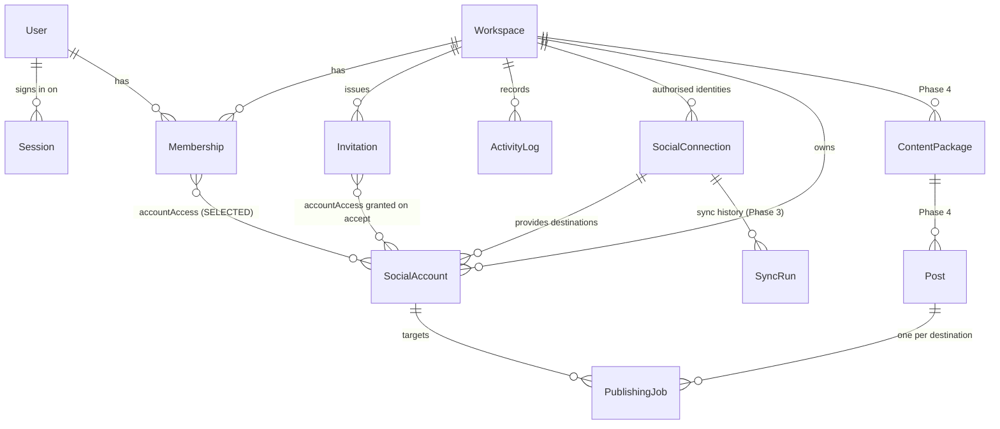
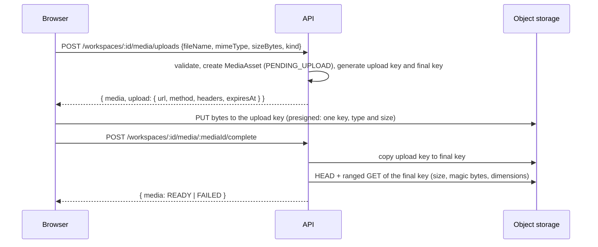
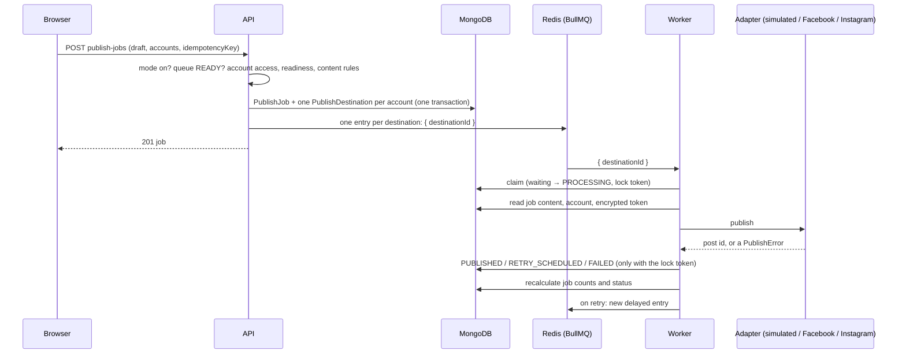

# SocialHub architecture

This document describes the data model and service boundaries.

- Phase 1 implements the foundation.
- Phase 2 adds the official Meta OAuth integration: multiple identities, discovery and
  selection of destinations, and token health.
- Phase 3 adds social account management: searchable destination and login views with
  computed health, synchronization with recorded history, least-privilege team access and
  detail pages.
- Phase 4 adds the composer backend, Phase 5 the publishing engine and Phase 6 the manual
  Facebook Group distribution workflow (see "Group distribution (Phase 6)" below).

## Guiding rules

1. **Separate entities for separate concepts.** These are never merged into one model:
   - OAuth identities (`SocialConnection`)
   - Publishing destinations (`SocialAccount`)
   - Content packages (`ContentPackage`)
   - Publishing requests (`PublishJob`)
   - Per-destination publishing records (`PublishDestination`)
2. **Workspace is the tenant boundary.** Every workspace-scoped document carries
   `workspace`, and every query is scoped by it.
3. **The API is the authority.** The RBAC matrix lives in `packages/shared` and both
   apps use it. The web app only uses it to hide controls; the API enforces every rule
   on its own.
4. **No secrets reach the browser.**
   - SocialHub's own access token is held in memory only.
   - The refresh token is an httpOnly cookie.
   - Third-party (Meta) tokens are AES-256-GCM encrypted at rest. They are `select: false`
     and stripped from every JSON response.
5. **Nothing pretends to work.** There is no publishing yet, and the UI says so. Meta is
   only ever reached through official endpoints; tests simulate it through a transport
   hook that production code refuses to install.

## Monorepo layout

```
packages/shared   RBAC matrix, domain enums, Zod schemas (used by API and web)
apps/api          Express 5 + Mongoose 9 REST API
  src/config        env validation (Zod), logger
  src/db            connection, transaction helper with standalone fallback
  src/lib           crypto, jwt, password, mailer, errors
  src/middleware    auth, workspace tenancy + permissions, validation, rate limits, errors
  src/models        one file per collection
  src/integrations/meta   HTTP client (appsecret_proof, timeouts, error classification,
                          one retry for transient GET errors), settings.js (configured Meta
                          apps; test-only override), facebook.js, instagram.js,
                          signedRequest.js — no business logic
  src/modules       auth · workspaces · members · invitations · activity
                    socialAccounts: socialAccount.service (accessibleAccountFilter, access
                          changes) · accountManagement.service (read models: list, summary,
                          detail, sync history, team access) · socialAccount.routes
                    meta: connectionHealth (pure rules: status, readiness, attention)
                          · metaOAuth.service (state/callback) · metaConnection.service
                          (connections, discovery, selection, sync + history, bulk sync,
                          disconnect, remove) · metaCallbacks.service (deauthorize, deletion)
  scripts           sync-indexes.js · sync-meta-connections.js (cron)
apps/web          React 19 + Vite 8 + Tailwind CSS 4 dashboard
  src/pages/workspace/accounts   Social accounts section (tabs + detail pages)
  src/components/accounts        shared account UI (table, filters, badges, dialogs)
  src/hooks                      useAccountActions (mutations), useSyncFlow, useAccountQueryState
```

## Data model



### Implemented (Phases 1–3)

| Model                            | Purpose                                                                                                                                                                                                                                                                                   | Key invariants (enforced by indexes)                                                                                                  |
| -------------------------------- | ----------------------------------------------------------------------------------------------------------------------------------------------------------------------------------------------------------------------------------------------------------------------------------------- | ------------------------------------------------------------------------------------------------------------------------------------- |
| `User`                           | Person with email/password login                                                                                                                                                                                                                                                          | unique `email` (lower-cased)                                                                                                          |
| `Session`                        | One signed-in device (a refresh-token family)                                                                                                                                                                                                                                             | unique `tokenHash`; TTL on `expiresAt`                                                                                                |
| `Workspace`                      | Tenant: one brand or client                                                                                                                                                                                                                                                               | unique `slug`                                                                                                                         |
| `Membership`                     | User ↔ workspace with role and `accountAccess` (default since Phase 3: `SELECTED` with no accounts)                                                                                                                                                                                       | unique (`workspace`,`user`); partial unique **one OWNER per workspace**                                                               |
| `Invitation`                     | Pending team invitation (hashed link token); optional `accountAccess` (P3) applied when accepted                                                                                                                                                                                          | unique `tokenHash`; partial unique one PENDING per (`workspace`,`email`)                                                              |
| `ActivityLog`                    | Append-only audit trail                                                                                                                                                                                                                                                                   | index (`workspace`, `_id` desc) for cursor paging; (`workspace`, `target.id`, `_id` desc) for per-record history                      |
| `SocialConnection`               | An OAuth identity (one Facebook login or one Instagram login). Holds the encrypted long-lived user token, granted/declined scopes, token and data-access expiry, status; P3 adds `lastSyncAttemptAt`, `lastSyncOutcome`, `syncLockedUntil` (`lastSyncedAt` is the last _successful_ sync) | unique (`workspace`,`provider`,`externalUserId`); index (`provider`,`externalUserId`)                                                 |
| `SocialAccount`                  | One destination: a Facebook Page or an Instagram professional account. Holds the encrypted Page/IG token, Page roles (`tasks`), connection status and publishing readiness; P3 adds `linkedFacebookPageName`                                                                              | unique (`workspace`,`platform`,`externalId`); index (`workspace`,`connection`)                                                        |
| `OAuthState` _(P2)_              | One in-flight authorization: hashed state, hashed browser binding, provider, purpose, workspace, user                                                                                                                                                                                     | unique `stateHash`; TTL on `expiresAt`                                                                                                |
| `MetaDataDeletionRequest` _(P2)_ | Confirmation record for a Meta data-deletion callback (hashed user id, counts)                                                                                                                                                                                                            | unique `confirmationCode`                                                                                                             |
| `SyncRun` _(P3)_                 | One synchronization attempt that reached Meta: trigger (`MANUAL`, `BULK`, `SCHEDULED`, `RECONNECT`), actor, start/finish/duration, outcome, status before/after, destinations refreshed/lost, classified error                                                                            | index (`connection`, `_id` desc) and (`workspace`, `_id` desc); TTL 90 days on `createdAt`; deleted with its connection and workspace |

**How multiple Facebook identities work:**

- A workspace holds any number of `SocialConnection`s, one per Facebook login (plus
  Instagram-Login identities).
- Each connection yields any number of `SocialAccount`s. Each account records the
  connection it came from.
- A Page that two identities can both reach is registered once per workspace.
- Connection health (`connectionStatus`) and publishing readiness (`publishingStatus`)
  are stored independently. A Page can have a valid token but lack publish permission.
  Since Phase 3 every API view also returns a computed `health` object (see
  [Account management](#account-management-phase-3)); clients should display that.

**Account access.** `Membership.accountAccess` is `{ mode: ALL | SELECTED, socialAccounts }`.

- OWNER and ADMIN always see every account.
- **Least privilege (Phase 3).** New memberships start as `SELECTED` with no accounts.
  `ALL` is only ever set explicitly. An invitation may carry an `accountAccess` grant
  (ignored for ADMIN invitations); on acceptance only the accounts that still exist are
  applied. Memberships stored before Phase 3 keep their values.
- `accessibleAccountFilter(membership)` in
  `modules/socialAccounts/socialAccount.service.js` is the **single enforcement point**.
  Every listing, summary and detail query starts from it, combined with any other
  condition through `$and`. The `loadSocialAccount` middleware uses it for every
  `/social-accounts/:accountId` route and answers `404` (never `403`) for destinations the
  member cannot use, so IDs cannot be probed. The Phase 4 composer and publishing engine
  must build their destination queries from it too.
- Access changes come in two shapes: replace the whole grant (`PUT …/account-access`) or
  change it incrementally (`PATCH …/account-access {add, remove}` per member, and
  `PATCH /social-accounts/:id/access {grant, revoke}` per destination). Removing one account
  from an `ALL` member converts them to `SELECTED` with every other current account.
  Incremental writes are conditional on the membership's `updatedAt` (optimistic
  concurrency), so a concurrent change answers `409` instead of being silently overwritten.
  The web editor therefore sends only the accounts added and removed (PATCH) while a member
  stays on selected accounts, and replaces the grant (PUT) only when switching to or from
  all accounts.

### Composer backend (Phase 4, implemented 2026-11-21)

| Model            | Purpose                                                                                                                                                                                                                                                 | Key invariants (enforced by indexes)                                                                                           |
| ---------------- | ------------------------------------------------------------------------------------------------------------------------------------------------------------------------------------------------------------------------------------------------------- | ------------------------------------------------------------------------------------------------------------------------------ |
| `ContentPackage` | The content of one post. In status `DRAFT` it is a composer draft: caption, per-platform captions, hashtags and their placement, internal SEO keywords, first comment, ordered media with alt text, target accounts, `version`, `createdBy`/`updatedBy` | index (`workspace`,`status`,`updatedAt` desc,`_id` desc) for the draft list; index `media.media`                               |
| `MediaAsset`     | One uploaded image or video: kind, status, declared name/type/size, verified dimensions and duration, server-generated `storageKey`, `uploadedBy`, `uploadExpiresAt`                                                                                    | unique `storageKey`; index (`workspace`,`_id`); indexes (`status`,`uploadExpiresAt`) and (`status`,`completedAt`) for clean-up |
| `AccountPreset`  | A named set of social accounts shared in a workspace                                                                                                                                                                                                    | unique (`workspace`,`nameKey`): one name per workspace, whatever the case                                                      |

**Drafts and optimistic concurrency.** Every save is a full replacement that names the
`version` it was based on. The update filters on that version and increments it in one
`findOneAndUpdate`, so a stale save matches nothing and answers `409`. Two people can never
silently overwrite each other, and no lock or transaction is needed.

**Account access.** Drafts and presets can only reference accounts their author can use
(`accessibleAccountFilter`).

**Draft visibility** (`modules/contentPackages/contentAccess.js`, 2026-11-21). A draft holds
unpublished content, so it is shown only to people who may use every account it is for:

| Role                               | Sees a draft or job when…                                 | Edits / deletes drafts                             | Publishes, schedules, cancels, retries        |
| ---------------------------------- | --------------------------------------------------------- | -------------------------------------------------- | --------------------------------------------- |
| Owner                              | always (every draft and job of the workspace)             | yes                                                | yes                                           |
| Admin                              | always                                                    | yes                                                | yes                                           |
| Editor with access to all accounts | always                                                    | yes                                                | yes                                           |
| Editor with selected accounts      | they may use **every** account it targets, or it has none | only what they can see; new targets must be theirs | only what they can see, to their own accounts |
| Viewer with access to all accounts | always                                                    | no (`403`)                                         | no (`403`)                                    |
| Viewer with selected accounts      | they may use **every** account it targets, or it has none | no (`403`)                                         | no (`403`)                                    |

- Owners and admins always have every account (`hasFullAccountAccess`), so they see every
  draft. A member with account access "all accounts" is treated the same way.
- For anyone else the server computes the workspace accounts they may **not** use and
  leaves out every draft that targets one of them. A draft that targets even one such
  account is not shown at all: no caption, no media, no account ids, not even that it
  exists. Hiding only the forbidden account names while returning the rest was the earlier
  behaviour and was replaced.
- Lists filter inside the MongoDB query (`targetAccounts: { $nin: restricted }`), so pages
  stay full and counts stay true; the page is checked again after the query.
- Reading, updating and deleting a hidden draft answer `404 Draft not found`, the same as an
  unknown id or another workspace's draft, so ids cannot be probed.
- A draft with no accounts follows the content permissions alone (`content:read` to see it,
  `content:create` to change it).
- Accounts removed from the workspace no longer restrict anyone.
- Publishing applies the same rule: a job can only be created from a draft the member can
  see (`404` otherwise, whichever accounts the request names), and a job is listed, counted
  and opened only by members who may use every account it was sent to. The web app's
  hidden buttons are a convenience; every rule above is enforced by the API and covered by
  `apps/api/test/draftPrivacy.test.js`.

**Media upload flow.**



- The API never proxies file bytes (the `local` development driver is the exception: it is
  both the API and the storage).
- Storage is behind one small interface (`src/storage`): `createUpload`, `stat`, `read`,
  `remove`, `publicUrl`. Drivers: `s3` (S3-compatible, SigV4 presigning implemented with
  `node:crypto`, no SDK) and `local`.
- **A verified file cannot be changed through its upload link.** The link is signed for the
  upload key only. Completion copies the object to a final key that no link can write to,
  then verifies that copy; one completion request at a time holds a short claim on the
  asset. Reusing the link later only rewrites the upload object, which the clean-up removes.
- **Bucket layout.** `uploads/<workspace>/<asset>/…` holds unverified uploads and is
  private. `workspaces/<workspace>/media/<asset>/…` holds verified files and is the only
  publicly readable prefix. The API's key needs put, get and delete on objects plus list on
  the bucket (so a missing object reads as 404, not 403); the API never lists.
- **Not yet verified against a real bucket.** The project uses the local driver, with
  `STORAGE_LOCAL_DIR="F:/Social Hub Data"` (verified live on 2026-11-21). The folder is
  created at start; `uploads\` holds unverified files and `workspaces\` verified ones, the
  same layout as the bucket. Local files cannot be fetched by Meta.
- Nothing is `READY` until the stored object has been verified. Abandoned slots and unused
  files are removed by `scripts/cleanup-media.js`.

### Publishing (Phase 5, implemented 2026-11-21)

| Model                | Shape (summary)                                                                                                                                                                                                                                                                                                                                                                                                                                                                                           |
| -------------------- | --------------------------------------------------------------------------------------------------------------------------------------------------------------------------------------------------------------------------------------------------------------------------------------------------------------------------------------------------------------------------------------------------------------------------------------------------------------------------------------------------------- |
| `PublishJob`         | `workspace`, `contentPackage` + `contentVersion`, `content` (frozen copy: captions, hashtags, first comment, ordered media with kind and alt text), `mode` (`SIMULATED` / `LIVE`), `status` and `counts` (derived), `destinationCount`, `idempotencyKey` + `requestHash`, `scheduledAt`, `createdBy`, `startedAt`, `completedAt`, `draftTargetAccounts` (the draft's accounts when the job was made: who the job is hidden from). No credentials.                                                         |
| `PublishDestination` | `workspace`, `job`, `contentPackage`, `socialAccount`, `platform`, account name snapshot, `state`, `active`, `simulated`, `attemptCount` / `maxAttempts`, `queueSeq`, `scheduledAt`, `nextAttemptAt`, `dueAt`, `queuedAt`, `processingAt`, `completedAt`, claim (`lockToken`, `lockedUntil`), `sendingAt` (hand-over to the platform started), `authorizedBy` (whose permission the send relies on), `externalPostId`, `externalUrl`, `providerState`, sanitized `error`, `warnings`, `attempts` history. |

Indexes:

| Model                | Index                                                           | Purpose                                                   |
| -------------------- | --------------------------------------------------------------- | --------------------------------------------------------- |
| `PublishJob`         | `{workspace, _id:-1}`, `{workspace, status, _id:-1}`            | Lists, newest first, optionally by status                 |
| `PublishJob`         | unique `{workspace, createdBy, idempotencyKey}`                 | The same request creates one job                          |
| `PublishJob`         | `{contentPackage}`, `{content.media.media, status}`             | History of a draft; "is this file still needed by a job?" |
| `PublishJob`         | `{workspace, draftTargetAccounts}`                              | Jobs hidden because their draft targeted an account       |
| `PublishJob`         | `{status, updatedAt}`                                           | Recovery sweep: job status lagging behind destinations    |
| `PublishDestination` | unique `{job, socialAccount}`                                   | One destination per account per job                       |
| `PublishDestination` | unique partial `{contentPackage, socialAccount}` where `active` | One post can be on its way to an account only once        |
| `PublishDestination` | `{workspace, state}`, `{contentPackage, socialAccount, state}`  | Lookups and the "already published" check                 |
| `PublishDestination` | `{state, lockedUntil}`, `{state, dueAt}`                        | Recovery sweep: stale claims and overdue waiting entries  |

### Group distribution (Phase 6, implemented 2026-11-23)

People post in Facebook Groups by hand; SocialHub keeps the directory, the plan and the record
and never calls Facebook (Meta removed the Groups API in Graph API v19.0). Details:
[GROUP_SHARING.md](GROUP_SHARING.md).

| Model           | Shape (summary)                                                                                                                                                             | Indexes                                                                                                                                           |
| --------------- | --------------------------------------------------------------------------------------------------------------------------------------------------------------------------- | ------------------------------------------------------------------------------------------------------------------------------------------------- |
| `GroupCategory` | Directory category of a workspace                                                                                                                                           | unique `{workspace, nameKey}`                                                                                                                     |
| `FacebookGroup` | Name, canonical link and `urlKey`, category, tags, approximate members, rules/notes, `minDaysBetweenShares`, ACTIVE/ARCHIVED, `lastSharedAt` (kept in step with done tasks) | unique `{workspace, urlKey}`; `{workspace, status, name}`, `{workspace, category}`, `{workspace, tags}`                                           |
| `GroupShare`    | Title, text and optional link to post                                                                                                                                       | `{workspace, _id:-1}`                                                                                                                             |
| `SharingTask`   | One share in one group: OPEN/DONE/SKIPPED, assignee, due date, who finished it and when, post link, note                                                                    | unique `{share, group}` (duplicate prevention); `{workspace, status, _id:-1}`, `{workspace, assignee, status}`, `{group, status, completedAt:-1}` |

A group's `minDaysBetweenShares` keeps new tasks away until it allows another share. Task
updates are conditional on the task's `status` and `updatedAt`, so two people finishing the
same task get one success and one `409`.

### Analytics (Phase 7, implemented 2026-11-23)

Insights are stored per source (`META` or `SIMULATED`), so demo data can never be read as Meta
data. Metrics are a fixed normalized set; an unreported metric is absent, never 0. Details:
[ANALYTICS.md](ANALYTICS.md).

| Model              | Shape (summary)                                                                                                                              | Indexes                                                                                                                                         |
| ------------------ | -------------------------------------------------------------------------------------------------------------------------------------------- | ----------------------------------------------------------------------------------------------------------------------------------------------- |
| `AccountInsight`   | One calendar day (`YYYY-MM-DD`) of metrics for one account from one source, `fetchedAt`, `syncRun`                                           | unique `{socialAccount, source, day}`; `{workspace, source, day}`                                                                               |
| `PostInsight`      | Lifetime metrics of one SocialHub delivery (`publishDestination`) from one source; `externalPostId` only for `META`                          | unique `{publishDestination, source}`; `{workspace, source, socialAccount}`                                                                     |
| `AnalyticsSyncRun` | One sync of one account: source, status, `active`, day range (`since`/`until`), attempts, `queueSeq`, `dueAt`, claim, safe `error`, `result` | unique partial `{socialAccount, source}` where `active`; `{workspace, socialAccount, createdAt:-1}`; `{status, lockedUntil}`, `{status, dueAt}` |

`PublishDestination` gained `{workspace, socialAccount, createdAt}` and
`{workspace, state, completedAt:-1}` for the publishing figures. No token is stored in any of
these collections.

## Meta integration (Phase 2)

### Connect flow

```mermaid
sequenceDiagram
  participant B as Browser (web app)
  participant A as SocialHub API
  participant M as Meta (facebook.com / instagram.com / Graph API)
  B->>A: POST /workspaces/:id/meta/authorizations {provider}
  A->>A: check social_connections:manage; create OAuthState(hash(state), hash(binding))
  A-->>B: {authorizationUrl} + Set-Cookie sh_oauth_<hash>=binding (httpOnly, Lax, /api/v1/oauth)
  B->>M: navigate to consent dialog (state)
  M-->>B: 302 to /api/v1/oauth/:provider/callback?code&state
  B->>A: GET callback (+ binding cookie)
  A->>A: state exists, unused, unexpired, same provider; cookie matches; consume atomically; re-check role
  A->>M: code → short-lived token → long-lived token; /me, /me/permissions, debug_token
  A->>A: upsert SocialConnection (same identity = update; new identity = new row); encrypt token; audit
  A-->>B: 302 /oauth/meta/result?status&reason&workspace&connection (no secrets)
  B->>A: GET …/social-connections/:cid/discovery (live /me/accounts, paginated)
  B->>A: POST …/social-connections/:cid/accounts {selected}
  A->>M: re-discover; only accounts the identity really manages are accepted
  A->>A: create/refresh SocialAccounts with encrypted Page/IG tokens; audit
```

### Rules

- **Identity versus destination.**
  - `SocialConnection.externalUserId` is the person's app-scoped ID. Facebook Login and
    Instagram Login each have their own.
  - `SocialAccount.externalId` is the Page ID or the Instagram professional account ID.
  - A Page-linked Instagram account uses its Page's token. An Instagram Login account uses
    the Instagram user token.
- **Duplicates.** The unique destination index makes each account exist once per
  workspace. On selection:

  | Situation                                                           | Result                          |
  | ------------------------------------------------------------------- | ------------------------------- |
  | Account is new                                                      | Created                         |
  | Already added through this connection                               | Refreshed                       |
  | Held by another connection that is healthy                          | Skipped (`CONNECTED_VIA_OTHER`) |
  | Held by another connection that is expired, revoked or disconnected | Re-linked here (audited)        |

- **Health.** `effectiveStatus()` is applied on every read, so a passed token or
  data-access expiry shows as `EXPIRED` immediately. Meta OAuth error 190 sets the stored
  status:

  | Error                                                                        | Status    |
  | ---------------------------------------------------------------------------- | --------- |
  | 190 without a subcode ("access token has expired"), subcode 463, or code 102 | `EXPIRED` |
  | Any other 190 subcode (458, 459, 460, 464, 467 invalid token, 492)           | `REVOKED` |

  When a connection's status changes, its destinations follow.

  Other errors are classified as follows (`integrations/meta/http.js`):

  | Error                                                                                                 | Classification |
  | ----------------------------------------------------------------------------------------------------- | -------------- |
  | 4, 17, 32, 341, 368, 613, and the documented Business Use Case codes 80000–80006, 80008, 80009, 80014 | rate limited   |
  | 10, 200–299                                                                                           | permission     |
  | 1, 2, HTTP 5xx, network errors, or `is_transient: true`                                               | transient      |

- **Publishing readiness** (pure rule, `assessPublishing`): a destination needs the
  publishing permissions and, for Page-based destinations, the `CREATE_CONTENT` Page task,
  as Meta's Pages API documents. Publishing itself is Phase 4.
  - Meta's docs disagree on the token for Page-linked Instagram publishing (Page token
    vs User token). Both are stored: the Page token on the `SocialAccount`, the User
    token on its `SocialConnection`.
- **Revocation.**
  - `DELETE /me/permissions` removes the app for the person everywhere, so it is called
    only when no other workspace still holds a usable connection for that identity.
  - This applies to disconnect, remove and workspace deletion.
- **Meta callbacks.** `signed_request` is verified with HMAC-SHA256 and the matching app
  secret.
  - Deauthorize → connections `REVOKED`, tokens erased.
  - Data deletion → connections and their destinations deleted, member access lists
    cleaned; returns `{ url, confirmation_code }`.
- **Sync.** `syncConnection()` is used both by the manual endpoint and by
  `scripts/sync-meta-connections.js`. It:
  - validates the token (`debug_token` for Facebook);
  - refreshes Instagram tokens once they are at least 24h old;
  - re-reads permissions and destinations;
  - marks destinations the identity can no longer reach as `ERROR`.

  Phase 3 adds history, locking and bulk orchestration (next section). The cron script
  becomes a BullMQ repeatable job once the Phase 4 queue exists.

## Account management (Phase 3)

Phase 3 adds management views on top of the Phase 2 records. **No new destination or
identity model was introduced**: everything reads `SocialConnection` and `SocialAccount`;
the only new collection is the `SyncRun` history.

### Read model (`modules/socialAccounts/accountManagement.service.js`)

- Views are computed on every request from the stored documents and the **current** state
  of their login. Nothing derived is cached, so an expiry date that passes shows up
  immediately.
  - `accountView()` is the account JSON (token fields are never selected) plus a summary of
    its login, `linkedPage` for Instagram accounts and the computed `health`. The linked
    Page's `id` is included only when the member may use that Page; its name is shown
    either way.
  - `queryAccounts()` filters (platform, login, status, readiness, needs-attention, and text
    over name, username, ID, category, login name, linked Page and workspace), sorts (name,
    attention severity, last successful sync, date added) and paginates. It works in memory
    over at most 5,000 visible destinations per request; beyond that the response says
    `truncated: true`. Facets: `platform` counts everything visible, while status,
    readiness and attention count the platform and login scope being viewed, so filter
    options show stable totals.
  - `summarizeAccounts()` returns the dashboard figures. Login figures are returned only
    to roles with `social_connections:manage`; for everyone else `connections` is `null`.
  - `GET /social-accounts` (cross-workspace) is the union of every membership's accessible
    destinations. Each item carries its workspace and whether the user can manage it
    there. It is read-only.
  - Destination and login details add the permission picture, the last 10 sync runs and
    the last 20 activity entries for the record. History, activity and team access are
    `null` for roles that may not see them.

### Health rules (`connectionHealth.accountHealth`, pure)

| Situation (checked in this order)                                      | `connectionStatus` | `readiness`   | Attention code           |
| ---------------------------------------------------------------------- | ------------------ | ------------- | ------------------------ |
| The login no longer exists                                             | `ERROR`            | `UNAVAILABLE` | `ACCESS_LOST`            |
| Login expired (stored, or token / data-access expiry has passed)       | `EXPIRED`          | `UNAVAILABLE` | `CONNECTION_EXPIRED`     |
| Login revoked                                                          | `REVOKED`          | `UNAVAILABLE` | `CONNECTION_REVOKED`     |
| Login in error (for example a permission removed during sync)          | `ERROR`            | `UNAVAILABLE` | `CONNECTION_ERROR`       |
| Login disconnected                                                     | `DISCONNECTED`     | `UNAVAILABLE` | `DISCONNECTED`           |
| Login healthy but this destination is no longer reachable through it   | `ERROR`            | `UNAVAILABLE` | `ACCESS_LOST`            |
| A publishing permission is not granted                                 | `ACTIVE`           | `RESTRICTED`  | `MISSING_PERMISSIONS`    |
| Facebook-Login destination without the `CREATE_CONTENT` Page task      | `ACTIVE`           | `RESTRICTED`  | `MISSING_CREATE_CONTENT` |
| Facebook-Login destination whose Page role is unknown (never reported) | `ACTIVE`           | `RESTRICTED`  | `MISSING_CREATE_CONTENT` |
| Everything granted                                                     | `ACTIVE`           | `READY`       | —                        |

- While the login is active, `EXPIRING_SOON` (inside the warning window) and
  `SYNC_FAILED` (the last attempt did not succeed) are added as attention items. They do
  not change readiness.
- `eligibility.createContent` is `true`/`false` when Meta reported the Page role and `null`
  when it did not, or for Instagram Login (which has no Page role).
- A login's own `attention` (`connectionAttention`) covers its status, missing required
  permissions, upcoming expiry and a failed last sync. Destination problems are counted
  separately (`accountCounts.needsAttention`).
- `READY` means the permissions and Page role allow publishing. Nothing is published in
  Phase 3, and the UI labels it "Publishing permissions OK".

### Synchronization (`metaConnection.service.js`)

`syncConnection(connection, { actor, trigger })`:

1. **Configuration.** If the login's Meta app (Facebook Login or Instagram Login) is not
   configured, it answers `409 META_NOT_CONFIGURED` before anything else. No lock is
   taken, Meta is not called and no history is written, so a missing configuration can
   never look like a successful sync.
2. **Usable login.** A disconnected login, or one without a token, answers
   `409 META_RECONNECT_REQUIRED`.
3. **Lock.** An atomic `findOneAndUpdate` on `syncLockedUntil` (two minutes) allows one
   sync per login at a time; otherwise `409 SYNC_IN_PROGRESS`. The lock is always released.
4. **Run.** It validates the token, refreshes Instagram tokens when due, re-reads
   destinations, and maps the result:

   | Result                                         | Login status          | HTTP                   | `SyncRun.outcome`                               |
   | ---------------------------------------------- | --------------------- | ---------------------- | ----------------------------------------------- |
   | Success                                        | `ACTIVE`              | 200                    | `SUCCESS` (sets `lastSyncedAt`)                 |
   | Token expired / revoked                        | `EXPIRED` / `REVOKED` | 200                    | `TOKEN_EXPIRED` / `TOKEN_REVOKED`               |
   | Permission removed                             | `ERROR`               | 200                    | `PERMISSION_DENIED`                             |
   | Rate limited, transient failure, anything else | unchanged             | 502 `META_UNAVAILABLE` | `RATE_LIMITED` / `TRANSIENT_FAILURE` / `FAILED` |

5. **History.** Every attempt that reached Meta writes a `SyncRun` and updates
   `lastSyncAttemptAt` / `lastSyncOutcome`. `lastSyncedAt` only moves on success.
   Reconnecting records a `RECONNECT` run; the cron script records `SCHEDULED` runs.

- **Bulk.** `syncWorkspaceConnections()` (`POST /social-connections/sync`) and
  `refreshAccounts()` (`POST /social-accounts/refresh`, which syncs each distinct parent
  login once) run logins one after another, so Meta's rate limits are respected. One
  failure never stops the others. Every login gets a result: an `outcome` when Meta was
  contacted, or a `skipReason` when nothing was written: `CONFIG_REQUIRED`, `IN_PROGRESS`
  or `NEEDS_RECONNECT` (Meta was not contacted), or `SUPERSEDED` (the login was
  disconnected, reconnected or removed while Meta was answering).
- **Retries.** `metaRequest()` retries a `GET` once after a short delay when Meta's error is
  classified as transient. `POST` and `DELETE` are never retried.
- **Relationships.** Sync updates the existing records in place, keyed by the unique
  (`workspace`, `platform`, `externalId`) index, so it can never create duplicates or move
  a destination between workspaces.
- **Tests.** `integrations/meta/settings.js` lets tests switch a Meta app off
  (`setMetaSettingsForTests`). Like the transport hook, it refuses to run outside
  `NODE_ENV=test`.

### Web app

- `/w/:slug/accounts` is a tabbed section: Overview (dashboard), Logins, Facebook Pages,
  Instagram and Team access. Tabs that a role cannot use are hidden. Logins and their
  detail pages need `social_connections:manage`; Team access needs `members:manage`.
- Detail pages: `/accounts/logins/:connectionId` (login) and `/accounts/a/:accountId`
  (destination). Account selection moved to `/accounts/logins/:connectionId/select`, and
  the Phase 2 URL redirects there.
- Filters, sort and page live in the URL (`useAccountQueryState`). Every Sync, Refresh and
  Reconnect control goes through `useSyncFlow`, which reports the server's per-login
  results and never invents an outcome.

## Publishing engine (Phase 5)

Implemented 2026-11-21. Real publishing is disabled; see
[PUBLISHING_API.md](PUBLISHING_API.md) for states, guarantees and endpoints.



- **Where things live.**
  - `packages/shared/src/publishing.js`: states, legal transitions, `deriveJobStatus`,
    request schemas, content rules.
  - `apps/api/src/queue/publishQueue.js`: the only code that talks to Redis.
  - `apps/api/src/modules/publishing/`: service (API side), processor (worker side),
    worker starter, adapters, error mapping, backoff.
- **MongoDB is the source of truth; Redis only delivers.** A queue entry is
  `{ destinationId }`. Losing Redis data loses nothing: the recovery sweep adds entries for
  waiting destinations again. BullMQ's own retry is off (`attempts: 1`); retries are decided
  by the processor and stored on the destination.
- **Outbox order.** Records are written first, then queued. If Redis drops in between, the
  job stays recorded and is queued by the sweep. If Redis is down before, nothing is written
  and the API answers `503 QUEUE_UNAVAILABLE`. There is no in-memory substitute.
- **Claims.** A worker claims a destination with one atomic update and a private lock token.
  Only the claimant can finish it. Duplicate deliveries and concurrent workers are harmless.
- **Uncertain outcomes are never repeated automatically.** A committing call without an
  answer, or a claim that expired (15 minutes), ends as `OUTCOME_UNKNOWN` / `INTERRUPTED`.
- **Job status** is recalculated from the destinations after every change, guarded by a
  sequence number so concurrent recalculations cannot leave a stale value.
- **Adapters.** A job's own `mode` selects the adapter, and the processor refuses a job
  whose mode is not the server's current mode. A `SIMULATED` job can only ever reach the
  simulated adapter, which contacts nobody and returns no post id.
- **Real publishing is unreachable.** `PUBLISHING_MODE` accepts `disabled` and `simulated`
  only. `LIVE` exists in code and is exercised in tests through a test-only override.
  When live, media must be public HTTPS (checked at creation and again at publish time), so
  local-disk media can never be sent to Meta.
- **Tokens.** Read with `.select('+accessToken')` in the processor only, decrypted in
  memory, passed to the adapter, never stored or logged. Provider error text is sanitized
  before it is stored.
- **Worker placement.** Inside the API process by default; `npm run worker` runs it alone.
  Health: queue connection state, queue counts and the number of connected workers, shown
  on `/health`, `/publishing/status` and the Publishing screen.
- **Visibility.** Jobs follow the draft visibility rule above: a member with selected
  accounts sees a job only if they may use every account it targets.
- **Scheduling.** A scheduled job is a normal job whose destinations wait in `SCHEDULED`
  with a delayed queue entry. `PATCH /publish-jobs/:id/schedule` moves the destinations
  still in `SCHEDULED` to a new time: one atomic update per destination guarded by its
  state and `queueSeq`, then the old queue entry is removed (best effort) and a new delayed
  entry is added. An old entry that survives finds the destination not yet due and does
  nothing, and a destination a worker has already claimed is left alone. There is no
  second scheduler: Redis delayed entries plus the recovery sweep are the only timers.
- **Time zones.** The API takes one exact instant (ISO 8601 with offset). The web app picks
  a date and time in an IANA time zone (the workspace's by default, from Settings) and
  converts it with the platform's `Intl` data, refusing times that do not exist because the
  clocks change (`features/publishing/schedule.js`).
- **Composer Publish.** The composer saves the post as a team draft first, then creates the
  job with the selected accounts (`socialAccountIds`) and, if chosen, `scheduledAt`, with an
  idempotency key per distinct request. It shows the job's live per-account states
  afterwards. Publishing therefore needs team drafts on (`VITE_COMPOSER_SERVER_DRAFTS`);
  whether the server accepts or only simulates posts comes from `/publishing/status`.

## Analytics (Phase 7)

`modules/analytics/` reads publishing figures straight from `PublishJob` /
`PublishDestination` (always split by publishing mode) and insights from `AccountInsight` /
`PostInsight` for one source per request. Every read is limited to the member's accessible
accounts, and a job that touches an account the member may not use is left out, the same rule
as `contentAccess.js`. Date ranges are calendar days in the workspace time zone
(`analytics.time.js`).

Insights sync has its own BullMQ queue (`socialhub-analytics`), built with the publishing
queue's connection code, so a slow sync never delays publishing. The pattern matches the
publishing engine: MongoDB holds the run (`AnalyticsSyncRun`), Redis holds only its id, a
worker claims it with a lock token, retries are delayed queue entries, and a recovery sweep
re-queues lost or interrupted runs. Adapters: `simulated` (demo values, development only) and
`meta` (Graph API insights, not reachable from any `ANALYTICS_MODE` value yet).

## Request pipeline (API)

```
requestContext (X-Request-Id) → pino-http (redacted, lean) → helmet (CSP) → CORS (allow-list)
→ JSON body (100 kB) → cookies → per-minute API limiter
→ router: authenticate (JWT + live session) → loadWorkspace (membership or 404)
→ requirePermission(perm) → validate (strict Zod) → service → errorHandler (uniform JSON)
```

Error responses always look like this:

```json
{
  "error": {
    "code": "VALIDATION_ERROR",
    "message": "…",
    "requestId": "…",
    "details": { "fields": { "email": "…" } }
  }
}
```

## Authentication

- **Access token.** An HS256 JWT valid for 15 minutes. It carries `sub` (user) and
  `sid` (session).
  - Every request also checks that the session is still live. Logout, "sign out
    everywhere" and password resets therefore take effect immediately.
- **Refresh token.** 48 random bytes stored as SHA-256. It is sent as an httpOnly cookie
  (`SameSite=Lax`, `Secure` in production) scoped to `/api/v1/auth`.
  - It rotates on every refresh, using an atomic conditional update.
  - Replaying a rotated token revokes the whole session.
  - Exception: within a short grace window, a replay is treated as a benign multi-tab race
    (`REFRESH_RACE`). The client simply retries with the cookie the other tab received.
- **CSRF.** Cookie-authenticated endpoints (`/auth/refresh`, `/auth/logout`) require the
  `X-SocialHub-Client: web` header. Cross-site requests cannot send it without passing the
  CORS allow-list.
- **Passwords.** bcrypt with cost 12. Input is capped at 72 bytes (bcrypt's limit) rather
  than silently truncated. Unknown-email logins take the same time as wrong-password ones.
- **Re-authentication.** Deleting a workspace and transferring ownership both require the
  owner's password.

## Transactions

Multi-document operations run in a MongoDB transaction when the deployment supports it
(replica set or Atlas; detected at startup). These include:

- workspace creation, ownership transfer, invitation acceptance and workspace deletion;
- connection status changes together with their destinations;
- removing a connection with its destinations, its sync history and member- and
  invitation-access cleanup;
- account-access changes for one or several members (Phase 3), which are also guarded by
  optimistic concurrency;
- every audited change.

On a standalone server the same code runs without a transaction and applies compensating
writes on failure. A warning is logged at startup. Production should use a replica set.
